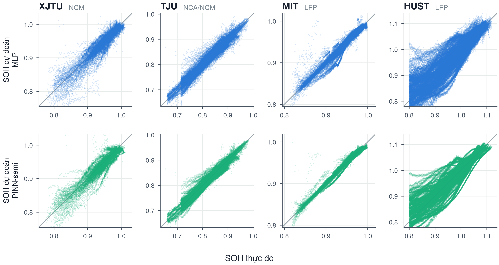
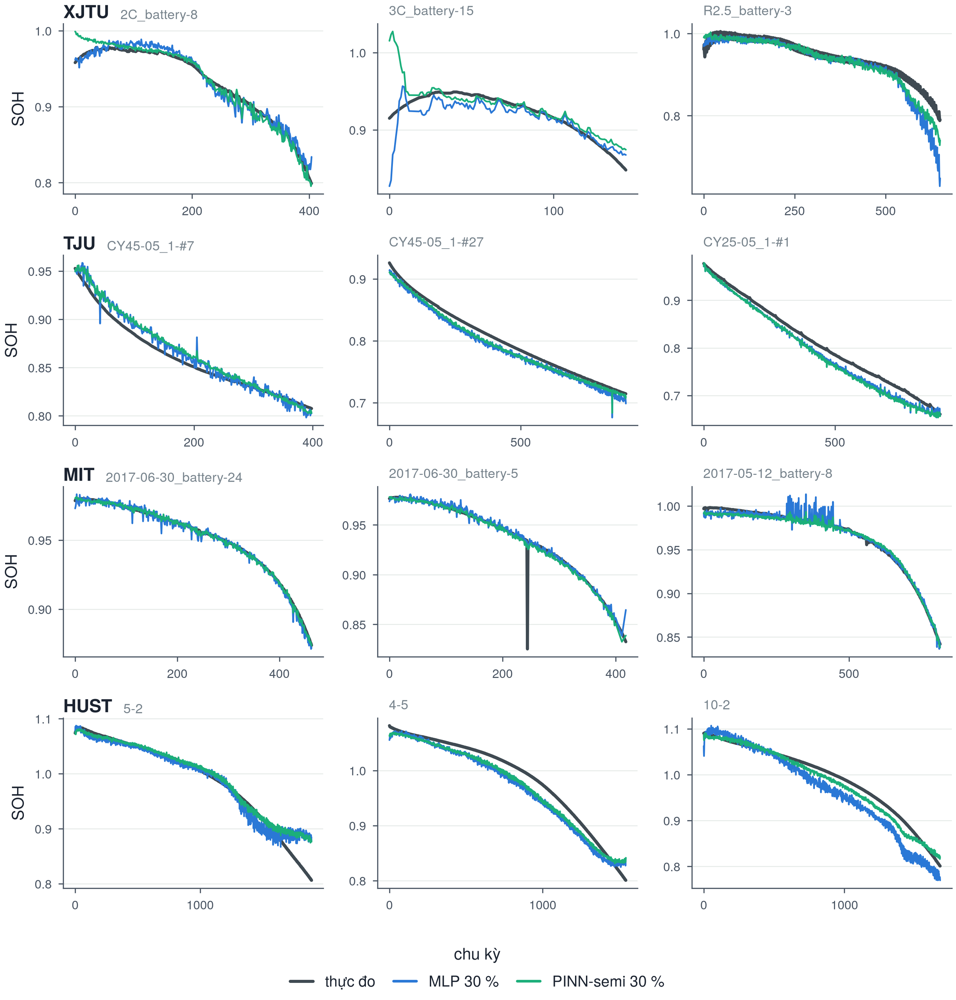
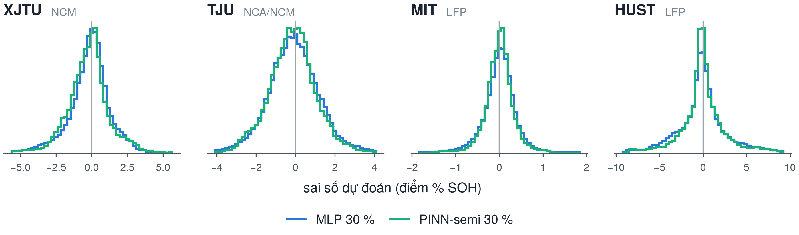
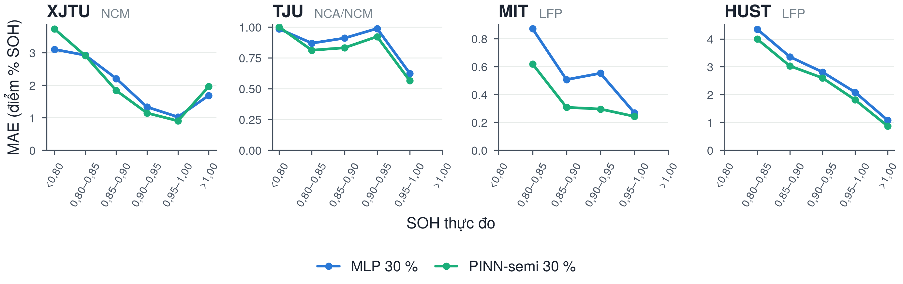
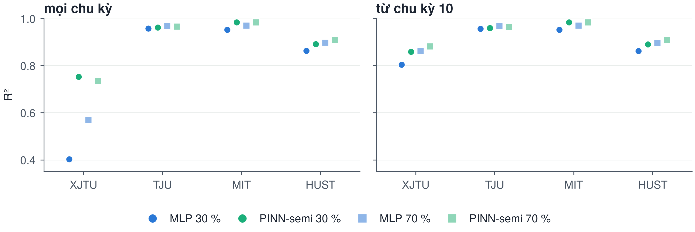
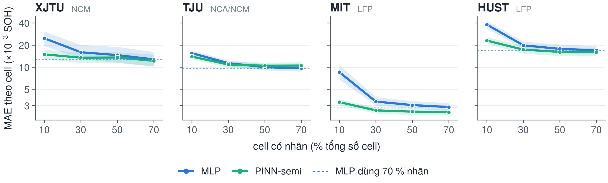

# 1. Các bộ dữ liệu

## 1.1. Nguồn gốc

Đề tài dùng bốn bộ dữ liệu lão hoá pin công khai, đều là cell hình trụ 18650 được sạc–xả lặp lại
trong phòng thí nghiệm cho tới khi dung lượng giảm sâu. Các đặc trưng đoạn sạc đã được trích sẵn
theo cùng một quy trình và công bố kèm mã nguồn của Wang và cộng sự (2024), nên bốn bộ có cùng 16
đặc trưng và so sánh được với nhau.

| Bộ | Nơi công bố | Hoá học cực dương | Số cell | Điều kiện thí nghiệm |
|------|------------------------------|-------------|-------|--------------------------------------------|
| XJTU | Đại học Giao thông Tây An — Wang và cs., *Nature Communications* 15, 4332 (2024) | NCM | 55 | 6 chế độ: sạc 2C, sạc 3C, xả ngẫu nhiên R2.5, R3, bước ngẫu nhiên RW, mô phỏng vệ tinh; nhiệt độ phòng |
| TJU | Zhu và cs., *Nature Communications* 13, 2261 (2022) | NCA, NCM, hỗn hợp NCM+NCA | 130 | 9 nhóm điều kiện, 3 mức nhiệt độ 25 / 35 / 45 °C và các tốc độ sạc khác nhau |
| MIT | MIT–Stanford–Toyota — Severson và cs., *Nature Energy* 4, 383 (2019) | LFP | 125 | Nhiều giao thức sạc nhanh khác nhau, 3 đợt thí nghiệm, buồng nhiệt 30 °C |
| HUST | Đại học Khoa học và Công nghệ Hoa Trung — Ma và cs., *Energy & Environmental Science* 15, 4083 (2022) | LFP | 77 | Cùng chế độ sạc nhanh, 77 chế độ xả nhiều bước khác nhau, 30 °C |

## 1.2. Đặc điểm dữ liệu sau xử lý

| Bộ | Cell | Số chu kỳ | Tuổi thọ (chu kỳ): nhỏ nhất / trung vị / lớn nhất | SOH đầu đời | SOH cuối dữ liệu | Dung lượng danh định |
|------|------|---------|--------------------|-------------|-------------|------------------------|
| XJTU | 55 | 22 431 | 110 / 392 / 942 | 0,83 – 1,00 | 0,78 – 0,89 | 2,0 Ah |
| TJU | 130 | 56 697 | 25 / 377 / 1 246 | 0,88 – 0,98 | 0,66 – 0,90 | 3,5 Ah (NCA, NCM), 2,5 Ah (NCM+NCA) |
| MIT | 125 | 82 450 | 36 / 622 / 2 156 | 0,95 – 1,00 | 0,82 – 0,97 | 1,1 Ah |
| HUST | 77 | 144 224 | 1 123 / 1 855 / 2 672 | 1,06 – 1,12 | 0,80 – 0,82 | 1,1 Ah |
| Tổng | 387 | 305 802 | | | | |

Bốn bộ khác nhau rõ rệt: XJTU và TJU là hoá học niken (NCM/NCA), tuổi thọ ngắn và điều kiện vận
hành đa dạng; MIT và HUST là LFP, tuổi thọ dài hơn nhiều. HUST có SOH ban đầu lớn hơn 1 vì dung
lượng thực tế của cell mới cao hơn dung lượng danh định. TJU là bộ duy nhất có nhiều mức nhiệt độ.

## 1.3. Cách áp dụng vào mô hình

Mỗi chu kỳ là một mẫu gồm 16 đặc trưng của đoạn sạc CC–CV (thống kê của điện áp và dòng điện,
điện lượng và thời gian sạc), chỉ số chu kỳ và nhãn SOH = dung lượng đo / dung lượng danh định.

1. Lọc chu kỳ lỗi: loại chu kỳ có đặc trưng không hợp lệ hoặc lệch xa so với 50 chu kỳ trước đó
   của chính cell. Bước này loại khoảng 1,6 % số chu kỳ.
2. Chuẩn hoá z-score mỗi đặc trưng bằng trung bình và độ lệch chuẩn của các cell huấn luyện.
3. Mỗi bộ dữ liệu được huấn luyện và đánh giá riêng. Dữ liệu được chia theo cell bằng kiểm định
   chéo 5 fold, lặp 5 lần: mỗi fold có 70 % cell huấn luyện, 10 % kiểm định, 20 % kiểm tra.
4. Trong số cell huấn luyện, chỉ một phần được dùng nhãn (10, 30, 50 hoặc 70 % tổng số cell).
   Các cell còn lại được dùng như cell chưa đo dung lượng: PINN-semi vẫn học từ dữ liệu sạc của
   chúng qua các ràng buộc vật lý, còn MLP bỏ qua chúng.
5. Nhiệt độ chỉ đi vào hệ số Arrhenius của mô hình động học. XJTU dùng 25 °C, MIT và HUST dùng
   30 °C, TJU dùng nhiệt độ của từng nhóm thí nghiệm.
6. Ngoài đánh giá trong từng bộ, mô hình còn được thử chuyển giữa hai bộ cùng hoá học:
   HUST ↔ MIT (LFP) và XJTU ↔ TJU (NCM/NCA).

# 2. Chỉ số đánh giá

Với $y_i$ là SOH thực đo, $\hat y_i$ là SOH dự đoán, $N$ là số chu kỳ trong tập kiểm tra:

$$
\mathrm{MAE} = \frac{1}{N}\sum_i |\hat y_i - y_i|, \qquad
\mathrm{RMSE} = \sqrt{\frac{1}{N}\sum_i (\hat y_i - y_i)^2}
$$

$$
\mathrm{MAPE} = \frac{100\,\%}{N}\sum_i \left|\frac{\hat y_i - y_i}{y_i}\right|, \qquad
\mathrm{MaxAE} = \max_i |\hat y_i - y_i|
$$

$$
R^2 = 1 - \frac{\sum_i (\hat y_i - y_i)^2}{\sum_i (y_i - \bar y)^2}
$$

MAE, RMSE và MaxAE được ghi theo điểm phần trăm SOH (nhân 100). Ngoài các chỉ số gộp mọi chu kỳ,
báo cáo còn dùng MAE theo cell (tính MAE cho từng cell rồi lấy trung bình, để cell có tuổi thọ dài
không lấn át) và trung vị của $R^2$ tính riêng trên từng cell.

# 3. Kết quả

## 3.1. Bảng chỉ số

Mỗi cell được dự đoán 5 lần (5 lần lặp kiểm định chéo); bảng gộp toàn bộ các lần dự đoán.

| Bộ | Mô hình | MAE (%) | RMSE (%) | MAPE (%) | R² | R² từ chu kỳ 10 | MaxAE (%) | MAE theo cell (%) | R² từng cell (trung vị) |
|------|---------------------|-------|-------|-------|-------|---------|--------|----------|----------|
| XJTU | MLP 30 % | 1,37 | 3,43 | 1,49 | 0,403 | 0,804 | 221,9 | 1,59 | 0,874 |
| XJTU | PINN-semi 30 % | 1,22 | 2,21 | 1,32 | 0,753 | 0,858 | 83,0 | 1,34 | 0,889 |
| XJTU | MLP 70 % | 1,17 | 2,91 | 1,27 | 0,570 | 0,863 | 212,6 | 1,27 | 0,909 |
| XJTU | PINN-semi 70 % | 1,12 | 2,28 | 1,22 | 0,736 | 0,882 | 103,0 | 1,22 | 0,893 |
| TJU | MLP 30 % | 0,93 | 1,27 | 1,15 | 0,958 | 0,957 | 21,8 | 1,13 | 0,935 |
| TJU | PINN-semi 30 % | 0,90 | 1,22 | 1,11 | 0,961 | 0,960 | 21,4 | 1,08 | 0,944 |
| TJU | MLP 70 % | 0,79 | 1,09 | 0,97 | 0,969 | 0,969 | 21,5 | 0,96 | 0,952 |
| TJU | PINN-semi 70 % | 0,82 | 1,14 | 1,02 | 0,966 | 0,965 | 21,0 | 1,05 | 0,949 |
| MIT | MLP 30 % | 0,39 | 0,74 | 0,41 | 0,953 | 0,952 | 23,4 | 0,34 | 0,987 |
| MIT | PINN-semi 30 % | 0,27 | 0,43 | 0,29 | 0,984 | 0,984 | 18,0 | 0,26 | 0,992 |
| MIT | MLP 70 % | 0,31 | 0,59 | 0,33 | 0,970 | 0,970 | 20,7 | 0,29 | 0,990 |
| MIT | PINN-semi 70 % | 0,25 | 0,43 | 0,27 | 0,984 | 0,984 | 17,5 | 0,24 | 0,993 |
| HUST | MLP 30 % | 1,96 | 2,90 | 2,10 | 0,863 | 0,862 | 22,3 | 1,98 | 0,910 |
| HUST | PINN-semi 30 % | 1,71 | 2,58 | 1,84 | 0,891 | 0,890 | 18,7 | 1,73 | 0,936 |
| HUST | MLP 70 % | 1,67 | 2,51 | 1,79 | 0,897 | 0,897 | 19,6 | 1,69 | 0,940 |
| HUST | PINN-semi 70 % | 1,57 | 2,37 | 1,70 | 0,909 | 0,908 | 16,2 | 1,60 | 0,943 |

Nhận xét:

- Cùng 30 % nhãn, PINN-semi tốt hơn MLP ở mọi chỉ số trên cả bốn bộ. Mức cải thiện lớn nhất ở MIT:
  RMSE giảm từ 0,74 xuống 0,43 điểm %, $R^2$ tăng từ 0,953 lên 0,984.
- Trên MIT và HUST, PINN-semi dùng 30 % nhãn đạt $R^2$ bằng hoặc cao hơn MLP dùng 70 % nhãn.
- TJU có $R^2$ cao (khoảng 0,96) với cả hai mô hình; ở đây thêm nhãn giúp nhiều hơn thêm vật lý.
- $R^2$ gộp của XJTU thấp vì 10 chu kỳ đầu của một cell (`RW_battery-1`). Đặc trưng sạc của cell
  này lúc mới chạy khác hẳn dữ liệu huấn luyện, nên mô hình đoán SOH khoảng 2,3 trong khi thực đo
  là 0,83. Chỉ khoảng 10 điểm này đã kéo $R^2$ của MLP 30 % xuống 0,40. Tính từ chu kỳ 10 trở đi,
  $R^2$ của XJTU là 0,80–0,88. PINN-semi bị ảnh hưởng ít hơn (MaxAE 83 so với 222 điểm %), nhiều
  khả năng nhờ ràng buộc giữ SOH trong miền giá trị hợp lý.

## 3.2. Dự đoán so với thực đo

*Hình 1. SOH dự đoán so với SOH thực đo trên tập kiểm tra, mỗi điểm là một chu kỳ. Hàng trên: MLP,
hàng dưới: PINN-semi, cùng 30 % nhãn.*

Điểm càng sát đường chéo thì dự đoán càng đúng. PINN-semi cho đám điểm hẹp hơn, nhất là ở MIT và
TJU. Ở HUST, cả hai mô hình đều dự đoán cao hơn thực tế khi SOH xuống dưới 0,85 (trung bình
khoảng 2–2,5 điểm %).

## 3.3. Quỹ đạo SOH theo chu kỳ

*Hình 2. Quỹ đạo SOH trên ba cell kiểm tra mỗi bộ: cell có sai số MLP ở phân vị 25 %, 50 % và
75 % của bộ đó.*

Cả hai mô hình bám sát đường thực đo trong phần lớn vòng đời. Dự đoán của PINN-semi trơn hơn và ít
dao động hơn MLP (ví dụ MIT `2017-05-12_battery-8`, đoạn chu kỳ 300–450). Sai số lớn nhất nằm ở cuối
đời của HUST, nơi cả hai mô hình chưa theo kịp tốc độ suy giảm nhanh.

## 3.4. Phân bố sai số

*Hình 3. Phân bố sai số dự đoán (dự đoán trừ thực đo) trên tập kiểm tra.*

Sai số của PINN-semi tập trung quanh 0 hơn, đặc biệt ở MIT và HUST. Ở HUST, phần lớn chu kỳ giữa
đời (SOH 0,90–1,00) bị dự đoán thấp hơn thực tế một chút, còn phần cuối đời (SOH dưới 0,85) bị dự
đoán cao hơn, nên phân bố có hai đuôi dài.

## 3.5. Sai số theo mức SOH

*Hình 4. MAE theo từng khoảng SOH thực đo.*

Sai số tăng khi pin già đi trên XJTU, MIT và HUST. Đây là giai đoạn quan trọng nhất khi quyết định
thay pin. PINN-semi có sai số thấp hơn MLP ở hầu hết các khoảng SOH, rõ nhất ở MIT trong khoảng
0,80–0,95.

## 3.6. Hệ số xác định R²

*Hình 5. $R^2$ theo bộ dữ liệu và mô hình; trái: mọi chu kỳ, phải: từ chu kỳ 10.*

## 3.7. Sai số theo lượng nhãn

*Hình 6. MAE theo cell khi số cell có nhãn tăng từ 10 % lên 70 %; vạch đứt là mức của MLP dùng
70 % nhãn.*

Khi nhãn càng ít, khoảng cách giữa PINN-semi và MLP càng lớn. Ở 10 % nhãn, sai số của PINN-semi
chỉ bằng khoảng 40 % sai số MLP trên MIT và khoảng 60 % trên XJTU và HUST.

# 4. Kết luận

- PINN-semi cho sai số thấp hơn và $R^2$ cao hơn MLP trên cả bốn bộ dữ liệu khi cùng 30 % nhãn.
  $R^2$ đạt 0,984 trên MIT, 0,961 trên TJU, 0,891 trên HUST và 0,858 trên XJTU (từ chu kỳ 10).
- Lợi thế lớn nhất khi có ít nhãn và trên pin LFP (MIT, HUST).
- Điểm yếu còn lại: dự đoán cuối đời trên HUST và các chu kỳ đầu của cell có điều kiện vận hành
  khác xa dữ liệu huấn luyện trên XJTU.

# Tài liệu tham khảo

1. Wang, F., Zhai, Z., Zhao, Z., Di, Y., Chen, X. (2024). Physics-informed neural network for
   lithium-ion battery degradation stable modeling and prognosis. *Nature Communications*, 15, 4332.
2. Zhu, J., Wang, Y., Huang, Y., et al. (2022). Data-driven capacity estimation of commercial
   lithium-ion batteries from voltage relaxation. *Nature Communications*, 13, 2261.
3. Severson, K. A., Attia, P. M., Jin, N., et al. (2019). Data-driven prediction of battery cycle
   life before capacity degradation. *Nature Energy*, 4, 383–391.
4. Ma, G., Xu, S., Jiang, B., et al. (2022). Real-time personalized health status prediction of
   lithium-ion batteries using deep transfer learning. *Energy & Environmental Science*, 15, 4083–4094.
