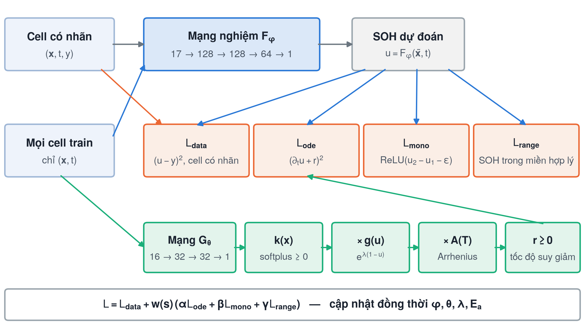
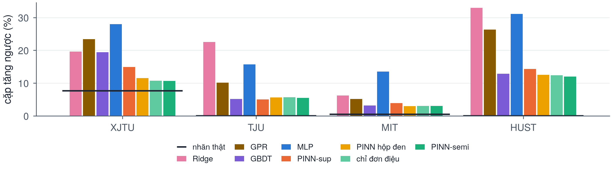
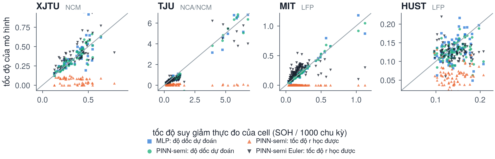
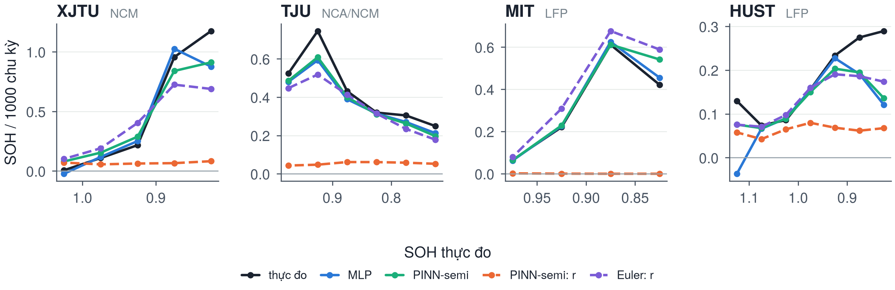
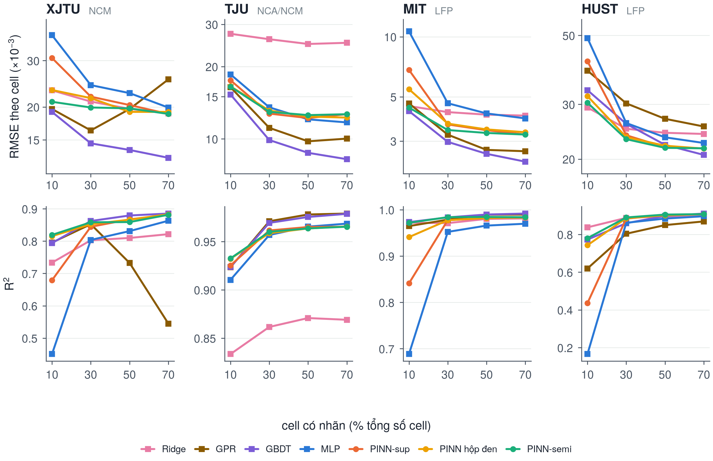

# 1. Mô hình gồm những gì

Mô hình có hai mạng. Mạng nghiệm $F_\varphi$ nhận 16 đặc trưng sạc đã chuẩn hoá $\tilde{\mathbf{x}}$ và thời gian
$t$ (chỉ số chu kỳ chia 1000), trả về SOH dự đoán $u$. Mạng tốc độ $G_\theta$ cùng hai tham số $\lambda$, $E_a$ mô tả
tốc độ suy giảm. Hai mạng chỉ gắn với nhau qua hàm mất mát; khi dự đoán SOH cho một cell chỉ cần $F_\varphi$.

{width=95%}

# 2. "Vật lý" ở đây là gì

Vật lý trong đề tài là vật lý ở mức hiện tượng: bốn quy luật định tính đã biết về lão hoá pin lithium-ion, được viết
thành phương trình và bất đẳng thức.

1. Dung lượng không tự tăng theo thời gian vận hành: lớp SEI dày lên và lithium bị mất khỏi chu trình là quá trình một
   chiều. Chỉ có hồi phục nhỏ sau thời gian nghỉ.
2. Suy giảm nhanh dần khi pin già: hiện tượng "đầu gối" ở giai đoạn cuối đời.
3. Phản ứng phụ tăng theo nhiệt độ, theo quy luật Arrhenius.
4. SOH nằm trong một miền hợp lý, và cell mới có SOH gần 1.

Bốn quy luật này được gom vào một phương trình suy giảm dạng xám:

$$\frac{\partial u}{\partial t} = -\,r(\tilde{\mathbf{x}}, u, T), \qquad
r = \underbrace{\operatorname{softplus}\big(G_\theta(\tilde{\mathbf{x}})\big)}_{k(\mathbf{x}) \,\ge\, 0}\;
\underbrace{e^{\lambda(1-u)}}_{\text{đầu gối}}\;
\underbrace{e^{-\frac{E_a}{R}\left(\frac{1}{T} - \frac{1}{T_\text{ref}}\right)}}_{\text{Arrhenius}}$$

"Xám" nghĩa là dạng của phương trình được cố định theo vật lý, chỉ phần tốc độ cơ sở $k(\mathbf{x})$ là học từ dữ
liệu. Đề tài không giải mô hình điện hoá chi tiết (P2D, mô hình hạt đơn) và không có phương trình nào cho chính các
đặc trưng sạc.

# 3. PINN nằm ở điểm nào

Mạng nghiệm $F_\varphi$ là một perceptron bình thường, giống hệt MLP đối chứng. Điểm làm mô hình thành PINN nằm ở
hàm mất mát và ở các điểm mà hàm mất mát được tính:

$$\mathcal{L} = \mathcal{L}_\text{data} + w(s)\big(\alpha\,\mathcal{L}_\text{ode} + \beta\,\mathcal{L}_\text{mono}
+ \gamma\,\mathcal{L}_\text{range}\big)$$

$$\mathcal{L}_\text{ode} = \overline{\Big(\frac{\partial F_\varphi}{\partial t}(\tilde{\mathbf{x}}_{n_1}, t_{n_1})
+ r(\tilde{\mathbf{x}}_{n_1}, u_1, T)\Big)^2}, \qquad
\mathcal{L}_\text{mono} = \overline{\operatorname{ReLU}(u_2 - u_1 - 0{,}002)}$$

| Hiểu biết vật lý | Biểu diễn | Tác động vào đâu | Cần nhãn |
|------------------|-----------|------------------|:--------:|
| Dung lượng không tăng theo thời gian | $\partial u/\partial t = -r$, $r \ge 0$ | đạo hàm riêng $\partial F/\partial t$ tại một chu kỳ, qua $\mathcal{L}_\text{ode}$ | không |
| Quỹ đạo SOH thật không tăng | $u_2 \le u_1 + 0{,}002$ | cặp chu kỳ $(n_1, n_2)$ thật của cùng cell, qua $\mathcal{L}_\text{mono}$ | không |
| Suy giảm nhanh dần khi già | $e^{\lambda(1-u)}$ | thừa số trong $r$ | không |
| Phụ thuộc nhiệt độ | Arrhenius $A(T)$ | thừa số trong $r$ | không |
| SOH trong miền hợp lý | các hàm ReLU chặn | giá trị $u$, qua $\mathcal{L}_\text{range}$ | không |
| Dung lượng đo được | $(u - y)^2$ | chu kỳ có nhãn, qua $\mathcal{L}_\text{data}$ | có |

Có ba điểm cần phân biệt.

- Điểm tính ràng buộc (điểm collocation) là mọi chu kỳ của mọi cell train, kể cả cell chưa đo dung lượng, ghép thành
  cặp $(n_1, n_2)$ cách nhau 5–50 chu kỳ. Đây là chỗ dữ liệu không nhãn đi vào mô hình. Đạo hàm
  $\partial F/\partial t$ tính bằng vi phân tự động.
- $\mathcal{L}_\text{ode}$ ràng buộc đạo hàm riêng theo $t$ khi giữ nguyên đặc trưng sạc. $\mathcal{L}_\text{mono}$
  ràng buộc tổng biến thiên dọc quỹ đạo thật, nơi cả đặc trưng lẫn thời gian cùng đổi. Hai ràng buộc tác động vào hai
  hướng khác nhau của $F_\varphi$; phần 4 đo riêng từng hướng.
- Vật lý chỉ có mặt lúc huấn luyện. Khi dự đoán, mô hình chỉ chạy $F_\varphi$: vật lý định hình hàm được học, chứ không
  tham gia vào phép tính dự đoán.

# 4. Kiểm chứng: vật lý tác động ra sao

## 4.1. Dọc quỹ đạo: dự đoán có đơn điệu không

Với mỗi cell test, đếm các cặp chu kỳ cách nhau ít nhất 10 chu kỳ mà SOH dự đoán ở chu kỳ sau cao hơn chu kỳ trước quá
0,002 (đúng ngưỡng của $\mathcal{L}_\text{mono}$). Phép đếm không cần nhãn; làm trên chính nhãn thật để có mức tham
chiếu. Số liệu ở 30 % nhãn, mọi cell test của 5 lần lặp.

| Bộ | Nhãn thật | MLP | GBDT | PINN-sup | PINN hộp đen | chỉ đơn điệu | PINN-semi |
|---|---------:|---:|----:|--------:|------------:|------------:|---------:|
| XJTU | 7,7 | 28,0 | 19,4 | 14,9 | 11,5 | 10,8 | 10,7 |
| TJU | 0,1 | 15,7 | 5,2 | 5,0 | 5,6 | 5,7 | 5,5 |
| MIT | 0,5 | 13,6 | 3,2 | 3,9 | 3,0 | 3,1 | 3,0 |
| HUST | 0,1 | 31,1 | 12,9 | 14,3 | 12,5 | 12,4 | 12,0 |

{width=100%}

Dự đoán của MLP tăng ngược ở 13,6–31,1 % số cặp, của PINN-semi chỉ
3,0–12,0 %, gần mức của nhãn thật
(0,1–7,7 %). Biến thể chỉ có ràng buộc đơn điệu cho tỉ lệ gần như
bằng PINN-semi (3,1–12,4 %), nên chính $\mathcal{L}_\text{mono}$ áp lên cặp chu kỳ của
cả cell không nhãn làm quỹ đạo dự đoán đơn điệu.

## 4.2. Theo thời gian: đạo hàm riêng và phần dư ODE

Đại lượng mà $\mathcal{L}_\text{ode}$ ràng buộc là $\partial F/\partial t$, chỉ tính được từ chính mô hình. Vì huấn luyện
là tất định, các lượt ở 30 % nhãn (lần lặp đầu, 5 fold, 4 bộ, 6 biến thể) được huấn luyện lại:
120/120 lượt cho MAE trùng từng bit với kết quả đã báo cáo. Trên cell test đo
$\partial F/\partial t$, tốc độ $r$, và tách tổng mức giảm SOH dự đoán trên vòng đời cell thành phần do biến thời gian
và phần do đặc trưng sạc:

$$\Delta u = \underbrace{\textstyle\sum_i \big[F(\tilde{\mathbf{x}}_i, t_{i+1}) - F(\tilde{\mathbf{x}}_i, t_i)\big]}_{\text{do thời gian}}
+ \underbrace{\textstyle\sum_i \big[F(\tilde{\mathbf{x}}_{i+1}, t_{i+1}) - F(\tilde{\mathbf{x}}_i, t_{i+1})\big]}_{\text{do đặc trưng sạc}}$$

| Đại lượng | XJTU | TJU | MIT | HUST |
|---------|----:|---:|---:|----:|
| ∂F/∂t > 0, MLP (%) | 11,8 | 32,6 | 30,3 | 17,4 |
| ∂F/∂t > 0, PINN-semi (%) | 0,8 | 2,6 | 23,9 | 4,8 |
| ∂F/∂t > 0, Euler (%) | 0,0 | 25,1 | 12,8 | 6,2 |
| phần do thời gian, MLP (%) | 15 | 9 | 3 | 36 |
| phần do thời gian, PINN-semi (%) | 18 | 15 | 2 | 49 |
| tốc độ r, PINN-semi | 0,061 | 0,058 | 0,001 | 0,063 |
| tốc độ r, Euler | 0,348 | 0,331 | 0,213 | 0,128 |
| tốc độ thực đo | 0,300 | 0,356 | 0,137 | 0,137 |

Tốc độ tính bằng SOH trên 1000 chu kỳ; phần do thời gian là trung vị qua các cell test.

- MLP có $\partial F/\partial t > 0$ (SOH tăng theo thời gian khi đặc trưng giữ nguyên) ở
  12–33 % số điểm; PINN-semi giảm xuống
  1–5 % trên XJTU, TJU, HUST. Trên MIT ràng buộc được thoả
  theo cách tầm thường: $r$ và $\partial F/\partial t$ cùng gần bằng 0, nên dấu của đạo hàm chỉ là nhiễu.
- Ở mọi mô hình, phần lớn mức giảm SOH dự đoán đi qua đặc trưng sạc: phần do thời gian chỉ
  2–49 % với PINN-semi. Mạng nhận ra pin đã già chủ yếu nhờ
  đường sạc đã đổi dạng; $\mathcal{L}_\text{ode}$ chỉ ràng buộc phần còn lại.

## 4.3. Tốc độ suy giảm học được

{width=100%}

Độ dốc của SOH dự đoán bám sát tốc độ thực đo của từng cell, ở cả MLP lẫn PINN-semi. Tốc độ $r$ của PINN-semi thì
không: trung bình chỉ 0,001–0,063 so với 0,137–0,356
thực đo, và gần như không tương quan với tốc độ từng cell (Spearman XJTU −0,26, TJU 0,10, MIT −0,14, HUST 0,09). Lý do: ở dạng đạo hàm riêng, $r$ được
khớp với $-\partial F/\partial t$, tức chỉ phần suy giảm mà mạng gán cho biến thời gian (mục 4.2). Biến thể Euler đặt
phương trình dọc quỹ đạo, $u(n_2) - u(n_1) + r\,\Delta t \approx 0$, nên $r$ của nó xấp xỉ tốc độ thật (trung bình
0,128–0,348; Spearman XJTU 0,72, TJU 0,88, MIT 0,66, HUST −0,22; trên HUST tốc độ các cell gần như nhau nên tương quan
không có ý nghĩa). Đổi lại, biến thể Euler có sai số cao hơn một chút trên TJU và MIT.

{width=100%}

Theo khoảng SOH, tốc độ thực đo tăng mạnh khi SOH giảm trên XJTU, MIT và HUST (hiện tượng đầu gối). Độ dốc dự đoán
theo sát xu hướng đó, nhưng $r$ gần như phẳng: với $\lambda \approx 0{,}96$ học được, thừa số $e^{\lambda(1-u)}$ chỉ tăng
khoảng 1,2 lần khi SOH giảm từ 1 xuống 0,8. Đầu gối trong dự đoán đến từ đặc trưng sạc, không từ thừa số đầu gối.
Năng lượng hoạt hoá $E_a$ cũng gần như không rời giá trị khởi tạo, vì ba trong bốn bộ chỉ có một mức nhiệt độ.

## 4.4. Phần nào mang lại lợi ích

- Ở 10 % nhãn, sai số theo cell của PINN-semi bằng 0,39–0,90 lần MLP; tính theo thang log,
  50–64 % mức giảm này đến từ việc áp vật lý lên cell không nhãn, phần còn lại từ vật lý
  trên cell có nhãn.
- Ở 30 % nhãn, riêng ràng buộc đơn điệu đã mang lại 62–95 % mức giảm sai số của PINN-semi
  so với MLP. Điều này khớp với mục 4.1–4.3: vật lý giúp chủ yếu qua ràng buộc dọc quỹ đạo.

# 5. R² và RMSE cho mọi mô hình

RMSE theo cell: căn của trung bình bình phương sai số của từng cell, trung bình qua các cell. $R^2$: trong một lần lặp,
5 fold phủ mỗi cell đúng một lần, nên dự đoán của 5 fold ghép thành dự đoán cho toàn bộ bộ dữ liệu; $R^2$ tính trên đó
(từ chu kỳ thứ 10 của mỗi cell) rồi trung bình qua 5 lần lặp. In đậm là tốt nhất trong cột của mỗi bộ.

RMSE theo cell (×10⁻³):

| Bộ | Mô hình | 10 % | 30 % | 50 % | 70 % |
|---|-------|----:|----:|----:|----:|
| XJTU | Ridge | 23,13 | 20,97 | 19,67 | 18,90 |
|  | GPR | 19,65 | 16,28 | 19,64 | 25,46 |
|  | GBDT | **19,15** | **14,54** | **13,73** | **12,81** |
|  | MLP | 37,49 | 24,21 | 22,58 | 19,89 |
|  | PINN-sup | 30,71 | 21,89 | 20,34 | 18,82 |
|  | PINN hộp đen | 23,20 | 21,61 | 19,16 | 19,15 |
|  | PINN-semi | 20,92 | 19,91 | 19,76 | 18,82 |
| TJU | Ridge | 27,40 | 26,01 | 24,85 | 25,13 |
|  | GPR | 16,42 | 11,12 | 9,77 | 10,03 |
|  | GBDT | **15,31** | **9,89** | **8,75** | **8,23** |
|  | MLP | 18,57 | 13,54 | 12,06 | 11,72 |
|  | PINN-sup | 17,55 | 12,75 | 12,22 | 12,67 |
|  | PINN hộp đen | 16,56 | 13,12 | 12,39 | 12,27 |
|  | PINN-semi | 16,51 | 12,96 | 12,56 | 12,67 |
| MIT | Ridge | 4,49 | 4,19 | 4,07 | 4,02 |
|  | GPR | 4,63 | 3,23 | 2,71 | 2,67 |
|  | GBDT | **4,24** | **2,97** | **2,59** | **2,36** |
|  | MLP | 10,65 | 4,64 | 4,12 | 3,90 |
|  | PINN-sup | 6,82 | 3,63 | 3,40 | 3,23 |
|  | PINN hộp đen | 5,46 | 3,67 | 3,43 | 3,32 |
|  | PINN-semi | 4,41 | 3,41 | 3,29 | 3,23 |
| HUST | Ridge | **29,31** | 25,04 | 24,30 | 24,10 |
|  | GPR | 38,52 | 30,22 | 26,95 | 25,46 |
|  | GBDT | 33,32 | 25,97 | 22,23 | **20,63** |
|  | MLP | 49,02 | 26,12 | 23,50 | 22,54 |
|  | PINN-sup | 41,27 | 23,87 | 21,84 | 21,66 |
|  | PINN hộp đen | 31,89 | 23,54 | 22,08 | 21,62 |
|  | PINN-semi | 30,37 | **23,18** | **21,74** | 21,66 |

$R^2$ (từ chu kỳ thứ 10):

| Bộ | Mô hình | 10 % | 30 % | 50 % | 70 % |
|---|-------|----:|----:|----:|----:|
| XJTU | Ridge | 0,733 | 0,803 | 0,810 | 0,822 |
|  | GPR | 0,796 | 0,852 | 0,733 | 0,545 |
|  | GBDT | 0,794 | **0,862** | **0,879** | **0,885** |
|  | MLP | 0,451 | 0,804 | 0,831 | 0,863 |
|  | PINN-sup | 0,679 | 0,844 | 0,867 | 0,882 |
|  | PINN hộp đen | 0,816 | 0,852 | 0,867 | 0,883 |
|  | PINN-semi | **0,819** | 0,858 | 0,859 | 0,882 |
| TJU | Ridge | 0,834 | 0,862 | 0,871 | 0,869 |
|  | GPR | 0,923 | **0,971** | **0,978** | **0,979** |
|  | GBDT | 0,924 | 0,969 | 0,975 | 0,979 |
|  | MLP | 0,910 | 0,957 | 0,965 | 0,969 |
|  | PINN-sup | 0,925 | 0,961 | 0,965 | 0,965 |
|  | PINN hộp đen | 0,932 | 0,959 | 0,964 | 0,966 |
|  | PINN-semi | **0,933** | 0,960 | 0,964 | 0,965 |
| MIT | Ridge | 0,972 | 0,971 | 0,980 | 0,981 |
|  | GPR | 0,965 | 0,979 | 0,989 | 0,990 |
|  | GBDT | **0,973** | 0,984 | **0,990** | **0,992** |
|  | MLP | 0,688 | 0,952 | 0,966 | 0,970 |
|  | PINN-sup | 0,841 | 0,978 | 0,982 | 0,984 |
|  | PINN hộp đen | 0,941 | 0,977 | 0,982 | 0,983 |
|  | PINN-semi | 0,972 | **0,984** | 0,985 | 0,984 |
| HUST | Ridge | **0,838** | 0,888 | 0,896 | 0,898 |
|  | GPR | 0,620 | 0,804 | 0,850 | 0,869 |
|  | GBDT | 0,773 | 0,860 | 0,898 | **0,911** |
|  | MLP | 0,166 | 0,862 | 0,884 | 0,897 |
|  | PINN-sup | 0,436 | 0,884 | 0,904 | 0,908 |
|  | PINN hộp đen | 0,743 | 0,887 | 0,902 | 0,908 |
|  | PINN-semi | 0,781 | **0,890** | **0,906** | 0,908 |

{width=100%}

- Thứ hạng các mô hình theo RMSE gần như trùng với theo MAE, nên mọi kết luận giữ nguyên khi đổi thước đo.
- Ở 10 % nhãn, $R^2$ của PINN-semi so với MLP:
  XJTU 0,82 so với 0,45, TJU 0,93 so với 0,91, MIT 0,97 so với 0,69, HUST 0,78 so với 0,17;
  RMSE theo cell của PINN-semi bằng 0,41–0,89 lần MLP, có ý nghĩa thống kê trên XJTU, TJU, MIT và HUST
  (Wilcoxon theo cell, hiệu chỉnh Holm).
- So với GBDT theo RMSE: GBDT tốt hơn có ý nghĩa ở 30 % (XJTU, TJU và MIT); 50 % (XJTU, TJU và MIT); 70 % (XJTU, TJU và MIT); PINN-semi tốt hơn có ý nghĩa ở 10 % (HUST); 30 % (HUST).
- Tính cả 10 chu kỳ đầu, $R^2$ của MLP trên XJTU ở 10 % nhãn chỉ còn −0,18: vài chu kỳ đầu
  có đặc trưng bất thường và một mình chúng kéo $R^2$ xuống.
- Chuyển miền: khi bộ đích chưa có nhãn, $R^2$ trung vị qua 12 cặp đều âm (MLP −2800, GBDT
  −2,1, PINN-semi −3,1), vì dự đoán lệch đều một khoảng lớn hơn độ biến
  thiên SOH của bộ đích; MAE là thước đo phù hợp hơn ở đây. Với 3 cell đích có nhãn: PINN-semi
  0,57, GBDT 0,55, MLP −2,5.

# 6. Tóm tắt

- Vật lý ở đây là bốn quy luật định tính của lão hoá pin, viết thành phương trình suy giảm dạng xám và các bất đẳng
  thức; chúng không dùng nhãn nên áp được lên cell chưa đo dung lượng.
- PINN nằm ở hàm mất mát và ở các điểm collocation (cặp chu kỳ của mọi cell train), không nằm ở kiến trúc hay ở bước
  dự đoán.
- Đo trên mô hình đã huấn luyện, vật lý tác động chủ yếu qua ràng buộc dọc quỹ đạo: dự đoán gần đơn điệu như nhãn
  thật. Ràng buộc ODE dạng đạo hàm riêng giữ cho SOH không tăng theo thời gian, nhưng tốc độ $r$ của nó không phải ước
  lượng tốc độ suy giảm của cell; dạng Euler cho $r$ sát tốc độ thật.
- Theo RMSE và $R^2$, PINN-semi tốt hơn rõ rệt MLP khi ít nhãn; GBDT vẫn tốt nhất ở phần lớn trường hợp khi có từ
  30 % nhãn trở lên.
